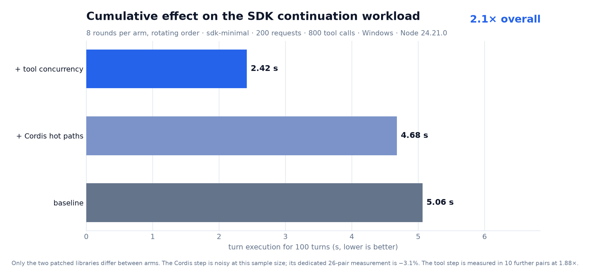

# Making DeepSeek Harness faster

[](https://github.com/tespio/dsh-performance/actions/workflows/ci.yml)

Two patches to [DeepSeek Harness](https://github.com/deepseek-ai/deepseek-harness) — one in the tool scheduler, one in its vendored Cordis framework — measured on the harness's own `profile-continuation` benchmark:

**5.06 s → 2.42 s for 100 turns (2.1×)**, from eight rotating rounds per arm, with only the patched libraries differing between arms.



| Patch | What it does | Measured |
|---|---|---|
| [`0002-tool-concurrency`](patch/0002-tool-concurrency.patch) | Four `isConcurrencySafe` declarations so read-only file tools run in parallel groups | **1.88× on turn execution** (43.8 → 23.3 ms/turn, 10/10 paired runs) |
| [`0001-cordis-hot-paths`](patch/0001-cordis-hot-paths.patch) | Lazy diagnostic errors, no Proxy binds in dispatch, gated waterfalls, cached tracing wrappers | **3.1% end-to-end** (26 paired runs, p = 0.0025); 4–9× on dispatch raw |

## Why these two

Profiling both processes of the workload (CPU profiles, then a config matrix) showed the turn is **latency-bound, not CPU-bound**: the child is idle 66% of the wall time and Cordis is 3.5% of sampled JS. The two biggest removable costs were waiting, not computation:

1. **Every tool call ran alone.** The scheduler only groups calls whose tool declares `isConcurrencySafe(args)`, and only two tools in the repository did — so eight read-only `view` calls ran back-to-back at ~4 ms each. Four declarations later, the turn is 1.88× faster.
2. **Every context read captured a stack nobody read.** `ctx.on`, `ctx.emit`, every service miss. The framework wins only a few percent end to end, but it also fixes a crash (`_hooks` on `Object.prototype`) and costs nothing at runtime.

Result ordering is unchanged: DeepSeek Harness' `batch.ts` commits tool results **in model order** even when calls overlap, and the chat UI keys tool nodes by `callId`. That is why the tool patch is four declarations rather than a scheduler change.

## Apply

```sh
git clone https://github.com/deepseek-ai/deepseek-harness
cd deepseek-harness
git apply -p1 /path/to/patch/0002-tool-concurrency.patch
git apply -p1 /path/to/patch/0001-cordis-hot-paths.patch
pnpm install
pnpm exec vitest run scripts/cordis-event-bus.spec.ts packages/fs/tool-fs-search packages/fs/tool-str-replace-editor packages/core
pnpm run build:artifacts
```

Both apply cleanly to `0.2.2-alpha.2` and touch disjoint files; either can be used alone. Details: [`docs/tool-concurrency.md`](docs/tool-concurrency.md), [`docs/applying.md`](docs/applying.md).

## What is measured, and how

- **End to end:** the shipped `sdk-minimal` profile with a synthetic model — 100 turns, 200 model requests, 800 real file-read tool calls. Every tool result is content-verified. Arms differ only in the built `lib/` of the patched packages; each run gets a fresh home and workspace.
- **Framework surface:** an in-process A/B harness that loads the pristine and patched Cordis sources side by side and alternates rounds per case.

Both are reproducible from this repository: [`e2e/`](e2e/README.md) and [`bench/`](bench/run.ts). Raw data lives in [`results/`](results/); every number in the charts comes from a committed JSON file.

## Repository layout

```
patch/      the two patches under test, plus the Cordis behavior spec
bench/      in-process A/B harness for the framework surface
e2e/        end-to-end harness and analysis for the product workload
charts/     chart generator and rendered PNG/SVG
results/    raw microbenchmark, end-to-end, chain, and profile data
docs/       findings, methodology, results, tool concurrency, profiling, applying
vendor/     pristine Cordis + Cosmokit sources used as the benchmark baseline
```

## Caveats

- One Windows machine (i7-13700KF), one synthetic profile, medians over 8–26 paired runs. Absolute microseconds are host-specific; the *removed work* is not.
- The tool result is far outside the noise; the framework result is small but consistent (sign test p = 0.0025).
- The workload reads the same file eight times per turn — the best case for tool concurrency. Mixed read/edit turns gain less; a single-tool turn gains nothing.
- Session `zstd` compression is worth another ~11% of a tool-heavy turn, but moving it off the append path changes the durability contract, so it is measured and documented rather than patched.
- This is a case study, not an upstreamed change: DeepSeek Harness does not accept external pull requests right now.

## License

MIT. Cordis and Cosmokit remain MIT by their authors; see [`NOTICE`](NOTICE).
