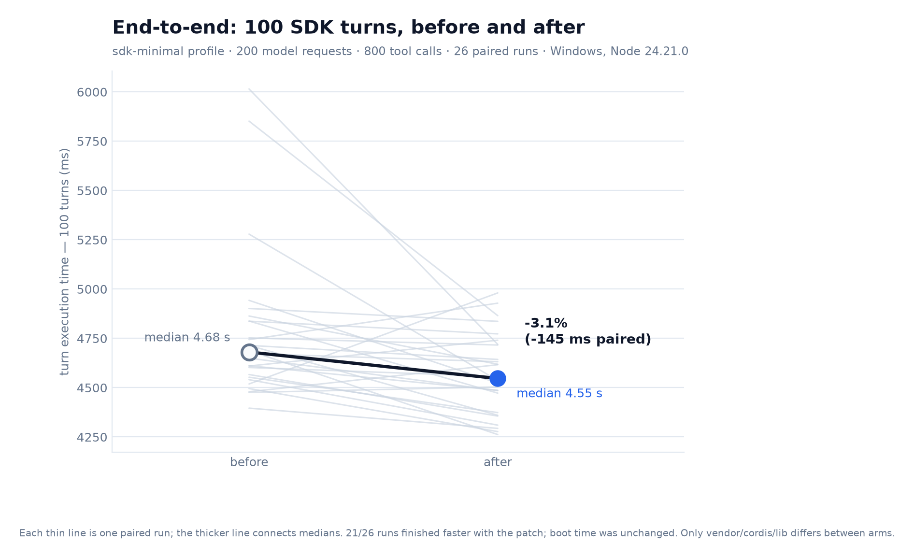

# End-to-end

The dispatch benchmark says where the framework spends its time. This page asks whether that shows up in a real agent run.

## Workload

DeepSeek Harness' own `profile-continuation` workload
(`benchmarks/agent-continuation/profile-continuation.worker.ts`), run against a
built `0.2.2-alpha.2` checkout:

- shipped `sdk-minimal` profile, started through the public SDK client;
- synthetic provider and tool, so no API key and no network;
- **100 turns** = 200 model requests + 800 real file-read tool calls through the
  production tool pipeline;
- a fresh home and workspace per run, so no session state carries over;
- 26 paired runs, alternating arm order.

Only `vendor/cordis/lib` differs between arms: the baseline and patched trees are
built once each (`build:artifacts`), then the built directory is swapped before
each run. Everything else — the CLI, the profile, every other package — is
byte-identical.

Harness and reproduction steps: [`e2e/`](../e2e/README.md).

## Results

| Metric | Before | After | Paired median | 95% CI | Runs faster |
|---|---:|---:|---:|---:|---:|
| Turn execution (100 turns) | 4 681 ms | 4 547 ms | **−145 ms (−3.1%)** | −5.0% … −1.2% | 21 / 26 |
| Total process lifetime | 5 370 ms | 5 236 ms | **−142 ms (−2.7%)** | −4.6% … −1.1% | 22 / 26 |
| Boot to ready | 662 ms | 658 ms | +1 ms (+0.2%) | −1.2% … +1.1% | 12 / 26 |
| Median per-turn | 43.6 ms | 42.0 ms | **−1.5 ms (−3.5%)** | −5.2% … −3.0% | 24 / 26 |

Sign test on the turn-execution pairs: p = 0.0025. The confidence interval is a
20 000-resample bootstrap of the median paired difference; raw per-run data is in
[`results/end-to-end/`](../results/end-to-end/summary.json).

## How to read it

- **The win is real but modest: about 1.5 ms per turn, 3% of this workload.**
  The workload is tool-heavy (8 file reads per turn) and the time is spread
  across the tool pipeline, session persistence and the SDK transport, so a
  change confined to the event bus and context proxy cannot dominate it.
- **Boot is unchanged**, which is the expected result: boot is plugin wiring and
  service resolution, and the patch barely moves `ctx.effect`.
- The two arms overlap. Two baseline runs landed above 5.8 s (GC or scheduling
  noise) while the rest cluster around 4.4–4.9 s; the paired median and the sign
  test are the honest summary, not the raw means.
- The gain should be larger where the event bus is busier than this profile —
  many listeners per agent event, high token-stream frame rates, or GUI
  projections. This page deliberately does not claim that; it measures the one
  profile DeepSeek Harness already benchmarks.

## Reproducing

See [`e2e/README.md`](../e2e/README.md). The short version: build the baseline,
snapshot `vendor/cordis/lib`, apply the patch, build again, snapshot, then
alternate arms and run `node e2e/analyze.mjs`.
