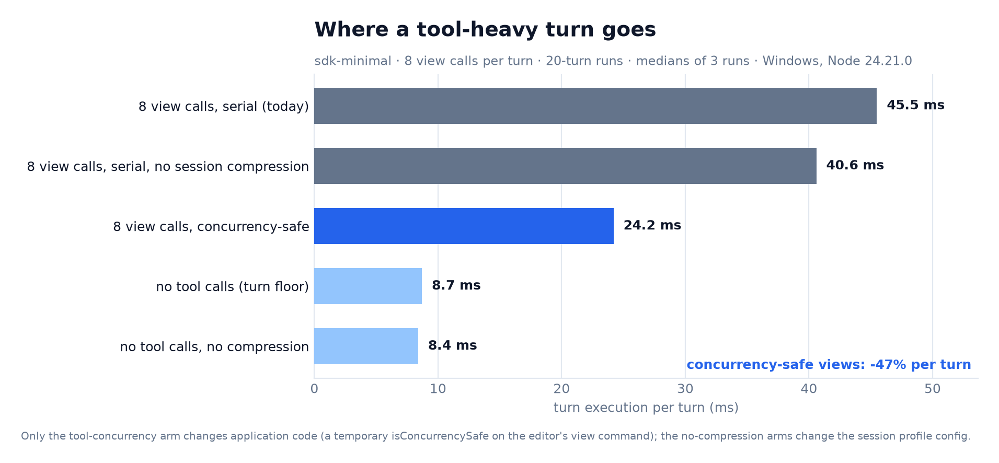

# Where the rest of the turn goes

The Cordis patch explains ~3% of a turn. This page is the follow-up question: what is the other 97%, and is any of it removable?

## Method

1. Ran the [end-to-end workload](end-to-end.md) with `--cpu-prof` on **both** processes (the SDK parent and the `dsh` child).
2. Because both turned out mostly idle, followed up with a small config matrix instead of more profiling: 20 turns per run, 3 runs per configuration, medians reported.

The workload is the shipped `sdk-minimal` profile with a synthetic model: each turn is one model request and eight `str_replace_editor` `view` calls against the same file.

## Results

| Configuration | ms / turn | What it isolates |
|---|---:|---|
| 8 `view` calls, serial (today) | **45.5** | the starting point |
| 8 `view` calls, serial, no session compression | 40.6 | session compression ≈ **4.9 ms** |
| 8 `view` calls, `view` marked concurrency-safe | **24.2** | tool serialization ≈ **21.3 ms** |
| no tool calls, compression on | 8.7 | the per-turn floor |
| no tool calls, no compression | 8.4 | compression on an empty turn ≈ 0.3 ms |

## Findings

### 1. Tool calls serialize, and that is half the turn

`ToolPipeline` classifies each call as `parallel` only when the tool declares `isConcurrencySafe(args)`; everything else is `exclusive` and runs alone. In the whole repository only two tools declare it (`tool-session-query`, `tool-subagent-oar`) — the file editor does not, even for `view`, which only reads.

Marking the editor's `view` command concurrency-safe (the version implemented in [`0002-tool-concurrency.patch`](../patch/0002-tool-concurrency.patch), measured at full scale in [`tool-concurrency.md`](tool-concurrency.md)):

- **45.5 → 24.2 ms per turn (−47%)**;
- all 160 tool results per run still carried the expected file content (the harness asserts it now);
- the model still received all eight results per turn.

That is roughly **15× the end-to-end win of the Cordis patch**, for a one-line annotation on a read-only command.

### 2. Session compression costs ~11% of a tool-heavy turn

With eight tool results per turn, `zstd` session compression costs about **4.9 ms per turn** (45.5 → 40.6). On a turn with no tool results the difference is ~0.3 ms, so the cost tracks bytes written, not turns. Options: compress off the critical path (batch/worker), lower the level, or compress only the persisted artifact rather than the live append.

### 3. The floor is 8.7 ms per turn

With no tools at all, a turn still costs ~8.7 ms: loop bookkeeping, session append, event fan-out and the SDK round trip. That is the price of a request that does nothing but return text; it is also the budget any further micro-optimization has to attack.

### 4. It is latency, not CPU

- child process: **66% idle** over the measured window;
- parent process: **95% idle**;
- Cordis, the largest JS contributor in the child, is 3.5% of sampled time.

So the per-turn cost is dominated by *waiting* — serialized tool calls, fs/zstd write latency, IPC round trips — not by JavaScript execution. This is why removing serialized waits is worth 10× more than optimizing the event bus, and why the Cordis work tops out at a few percent.

## What a real fix would take

- Add `isConcurrencySafe(args)` to the read-only commands of file tools (`view`, and equivalents in `glob`/`grep`/read-only shell commands). The contract already exists; the arguments are available, so safety can be per-command (`view` yes, `str_replace` no).
- Audit the consumers that assume serialized tool results: session event ordering, UI presentation, approval prompts. The loop's `Promise.allSettled` batch already tolerates concurrent settlements, but the *order* of `tool/result` events changes.
- Re-run DeepSeek Harness' `profile-continuation` benchmark before and after; the expected effect there is large but must be measured, not assumed.

## Caveats

- The numbers on this page come from the built-lib probe. The implemented change and its full-scale 10-run measurement are in [`tool-concurrency.md`](tool-concurrency.md) (1.88×, 10/10 paired runs).
- One machine, one profile, three runs per config; the tool-serialization result is far outside the noise, the compression result is two to three times the run-to-run spread.
- The workload reads the same file eight times, which is the best case for concurrency. Mixed read/edit turns would gain less.
