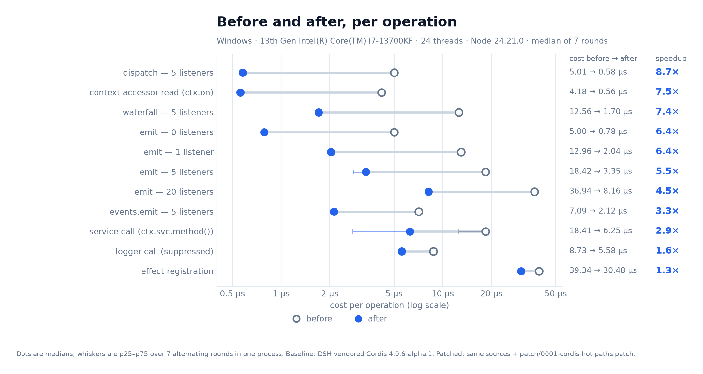

# Results

Generated by `bench/report.ts` from [`results/summary.json`](../results/summary.json). Medians with interquartile range over alternating in-process rounds.

| Case | Before (µs) | IQR | After (µs) | IQR | Speedup |
|---|---:|---:|---:|---:|---:|
| context accessor read (ctx.on) | 4.18 | 4.10−4.23 | 0.56 | 0.55−0.57 | **7.46×** |
| service call (ctx.svc.method()) | 18.41 | 12.60−19.16 | 6.25 | 2.78−6.34 | **2.95×** |
| emit, 0 listeners | 5.00 | 4.99−5.04 | 0.78 | 0.78−0.79 | **6.38×** |
| emit, 1 listener | 12.96 | 12.87−13.04 | 2.04 | 2.02−2.06 | **6.37×** |
| emit, 5 listeners | 18.42 | 17.93−18.48 | 3.35 | 2.80−3.39 | **5.50×** |
| emit, 20 listeners | 36.94 | 36.20−37.28 | 8.16 | 8.01−8.46 | **4.53×** |
| events service emit, 5 listeners | 7.09 | 7.01−7.17 | 2.12 | 2.02−2.14 | **3.35×** |
| dispatch, 5 listeners | 5.01 | 4.97−5.11 | 0.58 | 0.56−0.60 | **8.67×** |
| waterfall, 5 listeners | 12.56 | 12.42−13.27 | 1.70 | 1.67−1.72 | **7.38×** |
| effect registration | 39.34 | 38.57−40.99 | 30.48 | 30.21−31.05 | **1.29×** |
| logger call (suppressed) | 8.73 | 8.38−8.90 | 5.58 | 5.40−5.62 | **1.57×** |

## Host

- 13th Gen Intel(R) Core(TM) i7-13700KF, 24 threads, 32 GiB
- win32 x64, Node 24.21.0
- 7 rounds per case, full iterations
- `new Error()` costs 1.90 µs on this host; a plain object costs 10.1 ns
- measured 2026-11-04T22:07:49.234Z

The stack-capture cost is the lens for this table: rows that used to capture unused stacks improve most, and a host with cheaper `Error` construction would show smaller ratios for those rows even though the same work was removed.

