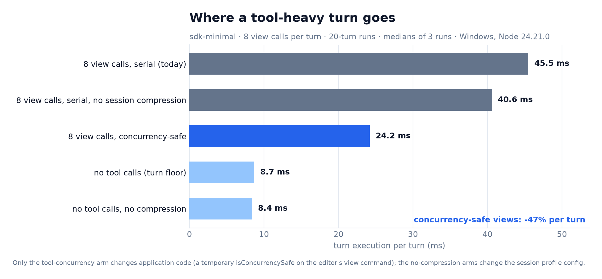

# Tool concurrency: the 1.88× win

The Cordis patch buys ~3% of a turn. The measurement that matters more is in the tool scheduler: **read-only tool calls never ran in parallel**, because almost no tool declares the classifier the scheduler already understands.



## The contract

`ToolPipeline` runs a call in a parallel group only when the tool declares `isConcurrencySafe(args)`; everything else is `exclusive`. The classifier receives the validated arguments, so safety can be per-command.

Across the repository only two tools declared it (`tool-session-query`, `tool-subagent-oar`). `read` and `read_image` did too, but `str_replace_editor`'s read-only `view`, `glob` and `grep` did not — so eight file reads in one step ran back-to-back at ~4 ms each.

## The change

Four declarations, no new mechanism:

```ts
// packages/fs/tool-str-replace-editor/src/index.ts
isConcurrencySafe: args => args.command === 'view'

// packages/fs/tool-fs-search/src/glob.ts and grep.ts
isConcurrencySafe: () => true
```

Mutation commands (`create`, `str_replace`, `insert`, `write`, `edit`), shell tools and stateful tools stay exclusive. Search spill files are per-call (`randomBytes(6)` prefix), so concurrent `glob`/`grep` cannot collide.

## Measured

100-turn `sdk-minimal` workload (200 model requests, 800 real tool calls), built application, only the changed packages' `lib/` swapped between arms, 10 paired runs:

| | serial (before) | concurrency-safe (after) |
|---|---:|---:|
| turn execution, median of 10 paired runs | 4,377 ms | **2,332 ms** |
| per turn | 43.8 ms | **23.3 ms** |
| | | **1.88× (−46.7%)**, 10/10 runs faster |

Every run still produced all 800 tool results, and the harness asserts each one contains the expected file content. Chained with the Cordis patch, the same workload goes from 4,680 ms to 2,332 ms (~2.0×).

## Why the result order does not change

`packages/core/tools/src/batch.ts` runs calls concurrently but commits results **in model order**: `commitReady()` only advances `committed` across contiguous slots, awaiting each slot in turn. Calls may overlap; the session sees `tool/call` and `tool/result` in the model's order.

Consumers are built for this anyway: the chat UI keys tool nodes by `callId`, ACP serializes updates through a promise tail, and the headless stream emits each event with its identity. Verified with 76 test files / 1,260 tests across `ui-chat`, `ui-deliverables` and `acp`, plus 49 files / 1,169 across the affected tool packages and `core`.

## Applying it

```sh
cd deepseek-harness
git apply -p1 /path/to/0002-tool-concurrency.patch
pnpm install
pnpm exec vitest run packages/fs/tool-fs-search packages/fs/tool-str-replace-editor packages/core
pnpm run build:artifacts
```

`0002` applies on top of `0.2.2-alpha.2` independently of `0001-cordis-hot-paths.patch`; the two touch disjoint files.

## Caveats

- One Windows machine, one synthetic profile with eight reads per turn — the best case for concurrency. Mixed read/edit turns gain less, and a turn with a single tool call gains nothing.
- The 4 ms per call is pipeline cost (session append, events, JSON), not filesystem latency; parallelising removes wall time, not CPU.
- `zstd` session compression is the next measured cost (~11% of a tool-heavy turn) and is **not** part of this change: moving it off the append path changes the durability contract.
